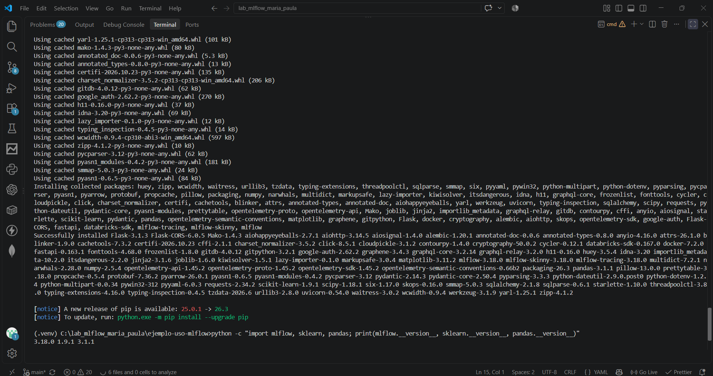
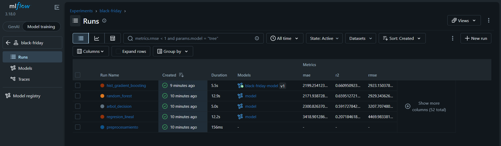
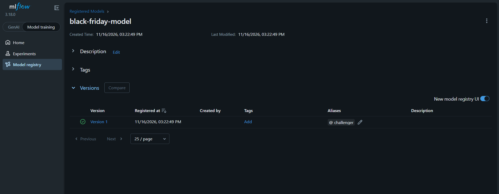
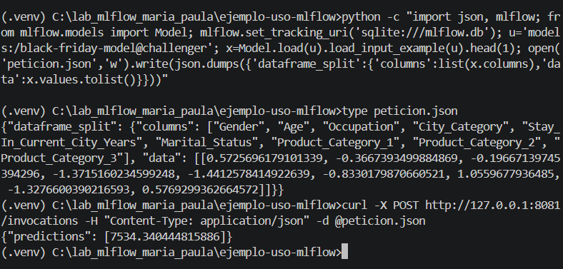
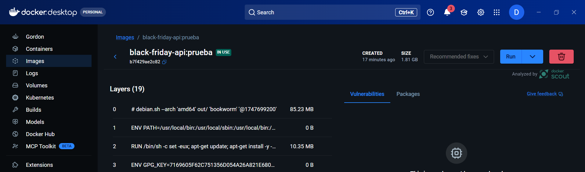

# Black Friday MLOps con MLflow

Flujo con MLflow para predecir el valor de una compra en Black Friday (`Purchase`): limpiar el conjunto de compras, entrenar cuatro regresores, registrar el mejor con el alias `challenger` y servirlo como API y como imagen Docker. El artefacto `model` es solo el estimador. La API recibe las nueve columnas ya codificadas y escaladas. Los pasos de limpieza, el mapa del `LabelEncoder` y la media y la escala del `StandardScaler` quedan en el run `preprocesamiento`.

Dataset: [Black Friday](https://www.kaggle.com/datasets/sdolezel/black-friday) (Kaggle), archivo `train.csv` con 550,068 compras.

Los nombres del experimento, del modelo y del alias salen de `.env` (`MLFLOW_EXPERIMENT_NAME`, `MLFLOW_MODEL_NAME`, `MLFLOW_MODEL_ALIAS`). En esta copia son `black-friday`, `black-friday-model` y `challenger`.

## Estructura

```
├── README.md                 # este documento
├── requirements.txt          # librerías con versión exacta
├── .env.example              # variables de ejemplo, sin secretos
├── .gitignore                # mlflow.db, mlruns/, .venv/, .env y el dataset
├── MLproject                 # mlflow run . --env-manager local
├── capturas/                 # pantallazos de la entrega
├── notebooks/
│   └── 01_exploracion.ipynb  # explorar y prototipar
├── src/
│   ├── config.py             # experimento, modelo y semilla
│   ├── data.py               # limpiar, codificar, escalar y partir
│   ├── train.py              # entrenar y dejar el regresor en MLflow
│   ├── register.py           # mejor run → alias challenger
│   ├── predict.py            # predecir con columnas ya transformadas
│   └── ejemplo_api.py        # documento de petición y respuesta
├── ejemplos-api/             # generado: un Markdown por modelo y alias
├── data/                     # train.csv, fuera de Git
├── mlflow.db                 # generado: parámetros, métricas, versiones
└── mlruns/                   # generado: modelos y artefactos
```

`mlflow.db` y `mlruns/` no están en el repositorio. MLflow los crea al entrenar o al abrir la interfaz.

## Datos

`data/` guarda el conjunto de trabajo. `DATA_PATH` es `data/train.csv` y ese archivo (25 MB) no se sube a Git. Hay que descargarlo de Kaggle y dejarlo en esa ruta. La política está en `data/README.md`.

Columnas: `User_ID`, `Product_ID`, `Gender`, `Age`, `Occupation`, `City_Category`, `Stay_In_Current_City_Years`, `Marital_Status`, `Product_Category_1`, `Product_Category_2`, `Product_Category_3` y el objetivo `Purchase`.

Preprocesamiento:

- Se descartan `User_ID` y `Product_ID` (identificadores con miles de valores distintos).
- Las categorías de producto vacías (`Product_Category_2` y `_3`) se rellenan con 0, que significa "sin categoría".
- Las columnas de texto (`Gender`, `Age`, `City_Category`, `Stay_In_Current_City_Years`) se codifican con `LabelEncoder`.
- Las features se escalan con `StandardScaler`. Quedan 9 features.
- Partición: 70 % entrenamiento y 30 % prueba, semilla 42.

## Instalar

Requisitos: Python 3.13 y Docker, si se va a construir la imagen.

En Windows (CMD):

```
python -m venv .venv
.venv\Scripts\activate
python -m pip install -r requirements.txt
copy .env.example .env
```

En Linux o macOS:

```bash
python3 -m venv .venv
source .venv/bin/activate
pip install -r requirements.txt
cp .env.example .env
```

`.env` es local. No lo subas a Git.

## Interfaz y almacén

Desde la raíz del proyecto, con el entorno activado. Esta terminal se queda ocupada:

```
mlflow ui --host 127.0.0.1 --port 5000 --backend-store-uri sqlite:///mlflow.db
```

La interfaz queda en http://127.0.0.1:5000. Lee `sqlite:///mlflow.db` y los archivos de `mlruns/`. El entrenamiento y el servicio van en otra terminal.

## Entrenar

`src/train.py` abre un run `preprocesamiento` y, después, un run por regresor: regresión lineal, árbol de decisión, random forest y gradient boosting (`hist_gradient_boosting`). Cada uno guarda MAE, RMSE, R2, parámetros y el estimador.

```
python src/train.py
```

También con MLflow (en Linux o macOS, carga antes `.env` con `set -a && source .env && set +a`):

```
mlflow run . --env-manager local
```

`--env-manager local` reutiliza el entorno ya instalado. Sin esa opción MLflow intenta crear otro entorno con pyenv.

Resultados sobre la partición de prueba (165,021 compras):

| Modelo                 | R2    | MAE   | RMSE  |
| ---------------------- | ----- | ----- | ----- |
| regresion_lineal       | 0.207 | 3,419 | 4,470 |
| arbol_decision         | 0.592 | 2,301 | 3,208 |
| random_forest          | 0.660 | 2,172 | 2,929 |
| hist_gradient_boosting | 0.661 | 2,199 | 2,923 |

La regresión lineal rinde poco porque la relación entre la categoría del producto y la compra no es lineal. Los modelos de árboles mejoran bastante.

## Registrar el challenger

`src/register.py` elige el run terminado con menor RMSE y publica ese modelo con el alias `challenger`. En esta copia gana `hist_gradient_boosting`.

```
python src/register.py
```

O con MLflow:

```
mlflow run . -e register --env-manager local
```

Predicción y servicio usan `models:/black-friday-model@challenger`, no un número de versión fijo. Cada ejecución crea una versión nueva y mueve el alias a ella.

El pipeline completo (entrenar, registrar y predecir):

```
mlflow run . -e pipeline --env-manager local
```

## Predecir en local

`src/predict.py` carga el modelo por alias y predice, sin levantar ningún servicio:

```
python src/predict.py
```

O con MLflow:

```
mlflow run . -e predict --env-manager local
```

## Servir el modelo

`mlflow models serve` expone el regresor. La petición lleva una fila ya codificada y escalada. Una fila produce un solo valor de compra.

```
mlflow --env-file .env models serve -m "models:/black-friday-model@challenger" --port 5001 --env-manager local
```

El servicio escucha en http://127.0.0.1:5001. Para regenerar el ejemplo de esa versión:

```
python src/ejemplo_api.py --modelo black-friday-model --alias challenger --puerto 5001
```

Eso escribe `ejemplos-api/black-friday-model__challenger.md`. La petición de una fila es:

```bash
curl http://127.0.0.1:5001/invocations \
  -H 'Content-Type: application/json' \
  -d '{"dataframe_split": {"columns": ["Gender", "Age", "Occupation", "City_Category", "Stay_In_Current_City_Years", "Marital_Status", "Product_Category_1", "Product_Category_2", "Product_Category_3"], "data": [[0.5725696179101339, -0.3667393499884869, -0.19667139745394296, -1.3715160234599248, -1.4412578414922639, -0.8330179870660521, 1.0559677936485, -1.3276600390216593, 0.5769299362664572]]}}'
```

La respuesta tiene esta forma:

```json
{ "predictions": [7534.340444815886] }
```

En CMD de Windows las comillas del `curl` suelen fallar. Guarda el JSON en un archivo `peticion.json` y envíalo así:

```
curl -X POST http://127.0.0.1:5001/invocations -H "Content-Type: application/json" -d @peticion.json
```

## Imagen Docker

`mlflow models build-docker` empaqueta el alias `challenger`. Dentro del contenedor el proceso escucha en el puerto 8080.

```
mlflow --env-file .env models build-docker -m "models:/black-friday-model@challenger" -n black-friday-api:prueba --env-manager local
```

Docker Desktop debe estar abierto. Para probarla en el puerto 8081 del equipo:

```
docker run --rm -p 8081:8080 black-friday-api:prueba
```

La misma fila, contra el contenedor:

```
curl -X POST http://127.0.0.1:8081/invocations -H "Content-Type: application/json" -d @peticion.json
```

`--rm` borra el contenedor al detenerlo con Ctrl+C.

## Cargar imagen a Docker Hub

```
docker login
docker tag black-friday-api:prueba tu_usuario_dockerhub/black-friday-api:latest
docker push tu_usuario_dockerhub/black-friday-api:latest
```

Sustituye `tu_usuario_dockerhub` por el usuario de Docker Hub.

## Qué no se versiona

| Ruta                   | Motivo                                               |
| ---------------------- | ---------------------------------------------------- |
| `.env`                 | valores locales; puede llegar a tener secretos       |
| `.venv/`, `.envmlops/` | entornos de Python                                   |
| `mlflow.db`            | metadatos generados: parámetros, métricas, versiones |
| `mlruns/`              | archivos generados: modelos y artefactos             |
| `data/train.csv`       | el conjunto de datos se descarga, no se sube         |
| `peticion.json`        | archivo auxiliar para probar la API                  |

## Capturas

### 1. Entorno



### 2. Runs y métricas en MLflow



### 3. Model Registry con el alias challenger



### 4. API respondiendo



### 5. Imagen Docker


